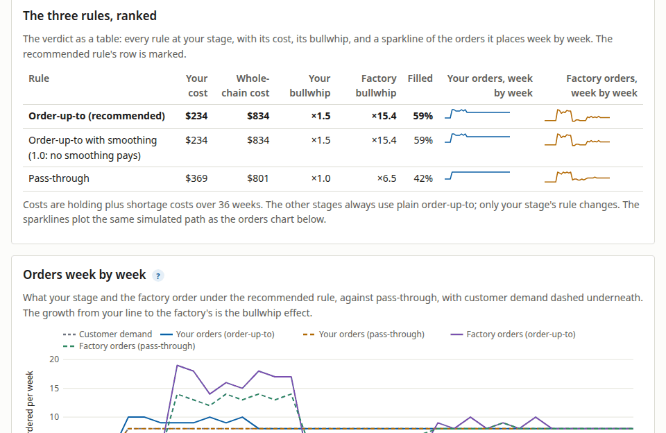
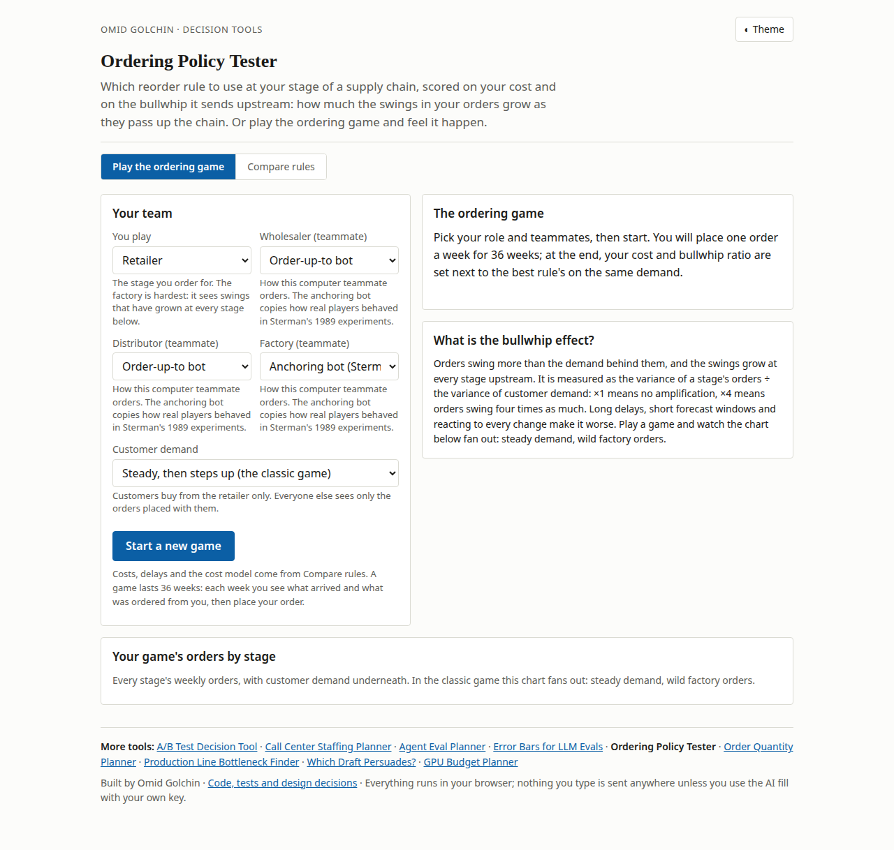

# Supply Chain Ordering Policy Tester

For anyone who orders stock for one stage of a supply chain: compare three ordering rules — order-up-to, order-up-to with smoothing, and pass-through — on what they cost your stage and how hard they whip the chain around, then play the ordering game yourself and feel why the bullwhip effect happens.





**Use it:** https://omidgolchin.github.io/ordering-policy-tester/ (runs in your browser; nothing you type leaves it)

## What it does

- **Compare policies.** Set your stage (retailer, wholesaler, distributor or factory), your lead time (order delay plus shipping delay), holding and shortage costs, and a demand pattern — steady with a step, constant, seasonal, random, or your own pasted series. The tool simulates a four-stage chain for 36 weeks and recommends a rule with its parameters: "Use order-up-to with smoothing 0.7 and a target of 30 units." You get your cost with its range over simulated demand, your bullwhip ratio (variance of your orders divided by variance of demand), the factory's, and the trade-off against the other rules.
- **Play the game.** Take one role for 36 weeks against bot teammates you choose — order-up-to bots, a pass-through bot, or the anchoring bot that orders the way Sterman's real players did. Each week you see what arrived and what was ordered from you, then place your order. The end screen sets your cost and bullwhip ratio next to the best rule's on the same demand.
- **Fill from my description (AI).** Describe your setup in your own words; a model (your key, or copy the prompt into any assistant) fills in the settings it can find, quotes your words for each one, and lists what you did not state. You confirm before anything is applied.

## Built-in checks

| Check | What it shows |
|---|---|
| Order-up-to target | The target decomposed: lead-time demand plus safety stock, and the service level that safety stock buys. |
| Information sharing | What happens to the factory's bullwhip if every stage plans against real customer demand instead of guessing from incoming orders — and when it barely helps (Lee, Padmanabhan and Whang, 1997). |
| Backlog vs lost sales | Whether the best rule changes if unfilled orders are lost sales instead of backlogs. It often does, upstream and on seasonal demand. |
| Smoothing trade-off | Your cost and your bullwhip ratio across smoothing factors 0.2 to 1.0 (Disney and Towill, 2003): calmer orders, slower reactions. |
| Anchoring bot | Sterman's (1989) fitted human heuristic — expectation weight 0.36, stock adjustment 0.26, supply-line weight 0.34 — as a selectable teammate in Play mode. |

## Design decisions

- **One stage is yours; the rest of the chain is fixed.** Only your stage's rule changes between comparisons, and your teammates use plain order-up-to. That isolates what your rule does, which is the decision you actually control.
- **Targets from the textbook formula.** S = mean demand × lead time + z × demand spread × √(lead time), z from the service level (Silver, Pyke and Thomas, 2016). Without information sharing, each stage estimates demand from its own incoming orders so far — the mechanism behind the bullwhip (Lee, Padmanabhan and Whang, 1997; Chen, Drezner, Ryan and Simchi-Levi, 2000).
- **The classic opening.** Every stage starts with 12 units and pipelines full at a steady flow of 4, as in Sterman's (1989) Beer Game, so a chain facing steady demand starts in steady state and any turbulence is the rules' fault.
- **The order is decided when it is placed.** A stage sees this week's incoming order before ordering, ships first, and pays costs on what is left — the weekly rhythm of the original game.
- **Random demand is a distribution, not a path.** Verdicts use the median of 20 demand paths and show the middle 80% range, so a lucky path cannot crown a rule.
- **The AI assist only reads.** It extracts settings from your description with a quote for each value; every number in the verdict comes from the simulator.

## Validation

- **18 tests** (`pytest`): the normal CDF/quantile helpers; the target formula by hand; order-up-to with zero lead time and known demand giving zero backlog; pass-through's bullwhip exactly 1 on a constructed case, with orders equal to incoming orders at every stage; smoothing factor 1 reproducing plain order-up-to exactly; the Sterman bot matching the published rule on a constructed state; lost sales cancelling instead of backlogging; information sharing cutting the factory's bullwhip; every verdict state (good / tie / warn) reached by a constructed case; the JavaScript engine against the Python reference (`sim/chain.py`) on three fixed games plus a full comparison; the AI assist's prompt, reply parsing and quote checks.
- **AI extraction: not yet run.** The 20-item test set (`assist/testset.json`) is scored with `node scripts/eval_assist.js` once a key for a current model is available (the tool budget is $0); the harness and the set ship with the tool.
- Checked on desktop (1366px) and phone (390px) widths with no console errors and no sideways scrolling; every example loads, and a full 36-week game completes by scripted clicks.

## What I learned

- Pass-through is embarrassingly strong on a one-off step. It cannot amplify, and the target-based rules spend weeks chasing the new level with targets estimated from pre-step orders. The rules that look naive win exactly when demand moves once and then holds still.
- Smoothing earns its keep only when demand keeps moving. On random demand it wins; on a step it just reacts late. The trade-off curve, not a slogan, is the right way to pick the factor.
- Fill rates are the honest shock. Even the best rule leaves a quarter of orders unfilled after a step, because the whole chain has to catch up at once. The bottleneck is the transition, not the steady state.
- The cost model is a modelling decision with teeth. Whether a stock-out backlogs or walks away flips the best rule at the distributor on seasonal demand ($368 pass-through under backlogs; $302 smoothing under lost sales, against $670) — and changes nothing at the retailer on the classic step.

## Research notes

Experiments run with the Python engine live in [`results/summary.md`](results/summary.md) (regenerate with `python -m sim.analyze`): the three rules on the classic game, information sharing cutting the factory bullwhip from ×120 to ×1.0 and chain cost from $1,374 to $396, four anchoring bots running up $2,464 of chain cost with bullwhips of ×4.0 / ×14.2 / ×38.5 / ×82.2 by stage, and the backlog-vs-lost-sales flip.

## Run it

Open `docs/index.html` in a browser, or serve the folder:

```
python3 -m http.server --directory docs 8000
```

Tests need Python 3.12 and Node:

```
python3.12 -m venv .venv && .venv/bin/pip install -r requirements.txt
.venv/bin/python -m pytest
```

## Layout

- `docs/` — the tool: `index.html`, `app.js`, the engine `chain.js`, the AI-assist config, and the shared tool kit (`kit.css`, `kit-theme.js`, `tool.css`, `tool-common.js`, unchanged across the tool family).
- `sim/` — the Python reference engine (`chain.py`), the JS agreement runner (`js_check.mjs`), and `analyze.py` for the research notes.
- `tests/` — engine, verdict-state, JS-agreement and assist tests.
- `assist/testset.json` — 20 descriptions with the settings a careful reader should extract.
- `scripts/eval_assist.js` — scores a model's extraction against the test set (needs an API key).
- `results/` — experiment summaries behind the Research notes.

## Limitations

- One product, one chain, no capacity limits, no ordering costs, no perishability. The factory has unlimited production capacity; real chains queue.
- Teammates in Compare mode always use plain order-up-to, and in Play mode the bots do not learn. The comparison answers "what should my rule be, given a conventional chain", not "what is the chain-wide optimum".
- Demand estimates in the no-sharing case use all orders received so far; a planner with a shorter memory would chase steps faster and calm down sooner. The choice is recorded in `DECISIONS.md`.
- Costs are linear and identical in structure at every stage; only your stage's cost is the verdict's headline.

## References

- Sterman, J. D. (1989). Modeling managerial behavior: Misperceptions of feedback in a dynamic decision making experiment. *Management Science*, 35(3), 321–339.
- Lee, H. L., Padmanabhan, V., & Whang, S. (1997). Information distortion in a supply chain: The bullwhip effect. *Management Science*, 43(4), 546–558.
- Chen, F., Drezner, Z., Ryan, J. K., & Simchi-Levi, D. (2000). Quantifying the bullwhip effect in a simple supply chain. *Management Science*, 46(3), 436–443.
- Disney, S. M., & Towill, D. R. (2003). The effect of vendor managed inventory (VMI) dynamics on the bullwhip effect in supply chains. *International Journal of Production Economics*, 85(2), 199–215.
- Silver, E. A., Pyke, D. F., & Thomas, D. J. (2016). *Inventory and Production Management in Supply Chains* (4th ed.). CRC Press.

## License

MIT — see `LICENSE`.
